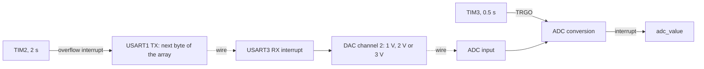

# Interrupt-driven timers, UART, DAC and ADC on STM32F0

STM32F091 · no HAL_Delay · timer-triggered ADC

   

**English** | [Türkçe](README.tr.md) · An open-source project by [TECH-OHM](https://tech-ohm.com)

An application that runs four peripherals without `HAL_Delay`, using only timers and interrupts. The main loop is empty. Each job runs in its own interrupt or from a timer trigger.

## What it does

1. TIM2 overflows every 2 seconds and sends the next value of a 50-element array over USART1.
2. Every byte received on USART3 sets the DAC output to one of three levels.
3. TIM3 triggers an ADC conversion every 0.5 seconds and the result is read in an interrupt.

If you connect USART1 TX to USART3 RX with a wire, the board receives what it sends and the DAC output steps every 2 seconds according to the array. Connect the DAC output to the ADC input and you see the whole chain end to end.

## Block diagram

## Pins

| Pin | Function |
|---|---|
| PA9 | USART1 TX, 9600 |
| PA10 | USART1 RX |
| PC4 | USART3 TX |
| PC5 | USART3 RX, 9600 |
| PA5 | DAC channel 2 output |
| PA0 | ADC channel 0 input |

For the loopback test connect PA9 to PC5 and PA5 to PA0.

## DAC levels

| Received byte | DAC value (12 bit) | Output |
|---|---|---|
| 0 to 100 | 1241 | 1 V |
| 101 to 200 | 2482 | 2 V |
| 201 to 255 | 3723 | 3 V |

## Timer math

The MCU runs from the internal 8 MHz oscillator.

| Timer | Prescaler | Period | Result |
|---|---|---|---|
| TIM2 | 8 | 2 000 000 | 8 MHz / 8 / 2 000 000 = 0.5 Hz, 2 seconds |
| TIM3 | 80 | 50 000 | 8 MHz / 80 / 50 000 = 2 Hz, 0.5 seconds |

TIM3 raises no interrupt. Its update event (TRGO) triggers the ADC directly, with no software in between. When the conversion ends `HAL_ADC_ConvCpltCallback` is called.

## Build

In STM32CubeIDE use `File > Import > Existing Projects into Workspace` and select this folder. The MCU is an STM32F091RC, compatible with the NUCLEO-F091RC board.

## License

MIT. The STM32 HAL and CMSIS files under `Drivers` keep their own licenses.

## Author

M. Eyüb Can, embedded systems engineer and founder of [TECH-OHM](https://tech-ohm.com)

## About TECH-OHM

[TECH-OHM](https://tech-ohm.com) designs electronic boards and embedded software, from the first schematic to series production. We also run a 12-month embedded systems training program and consult for engineering teams.

Web: [tech-ohm.com](https://tech-ohm.com) · Email: info@tech-ohm.com
