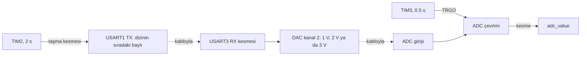

# STM32F091 ile zamanlayıcı, UART, DAC ve ADC'yi kesmelerle kullanma

Dört çevre birimini `HAL_Delay` kullanmadan, sadece zamanlayıcı ve kesmelerle çalıştıran bir uygulama. Ana döngü boş. Her iş kendi kesmesinde ya da zamanlayıcı tetiğiyle yürüyor.

## Ne yapıyor

1. TIM2 her 2 saniyede bir taşıyor ve 50 elemanlı bir dizinin sıradaki değerini USART1'den gönderiyor.
2. USART3'ten gelen her bayt DAC çıkışını üç seviyeden birine çekiyor.
3. TIM3 her 0.5 saniyede bir ADC çevrimini tetikliyor, sonuç kesmeyle okunuyor.

USART1 TX ile USART3 RX uçlarını bir kabloyla birleştirirsen kart kendi gönderdiğini alır ve DAC çıkışı dizideki değerlere göre 2 saniyede bir basamak basamak değişir. DAC çıkışını ADC girişine bağlarsan zinciri uçtan uca görürsün.

## Blok diyagram

## Pinler

| Pin | Görev |
|---|---|
| PA9 | USART1 TX, 9600 |
| PA10 | USART1 RX |
| PC4 | USART3 TX |
| PC5 | USART3 RX, 9600 |
| PA5 | DAC kanal 2 çıkışı |
| PA0 | ADC kanal 0 girişi |

Kendi kendine test için PA9'u PC5'e, PA5'i PA0'a bağla.

## DAC seviyeleri

| Gelen bayt | DAC değeri (12 bit) | Çıkış |
|---|---|---|
| 0 ile 100 | 1241 | 1 V |
| 101 ile 200 | 2482 | 2 V |
| 201 ile 255 | 3723 | 3 V |

## Zamanlayıcı hesapları

İşlemci dahili 8 MHz osilatörle çalışıyor.

| Zamanlayıcı | Ön bölücü | Periyot | Sonuç |
|---|---|---|---|
| TIM2 | 8 | 2 000 000 | 8 MHz / 8 / 2 000 000 = 0.5 Hz, 2 saniye |
| TIM3 | 80 | 50 000 | 8 MHz / 80 / 50 000 = 2 Hz, 0.5 saniye |

TIM3 kesme üretmiyor. Taşma olayı (TRGO) doğrudan ADC'yi tetikliyor, yazılım araya girmiyor. ADC çevrimi bitince `HAL_ADC_ConvCpltCallback` çağrılıyor.

## Derleme

STM32CubeIDE'de `File > Import > Existing Projects into Workspace` ile klasörü seç. İşlemci STM32F091RC, NUCLEO-F091RC kartıyla uyumlu.

## Lisans

MIT. `Drivers` klasöründeki STM32 HAL ve CMSIS dosyaları kendi lisanslarıyla gelir.

## Yazar

Gömülü Sistem Mühendisi M. Eyüb Can, [TECH-OHM](https://tech-ohm.com)
